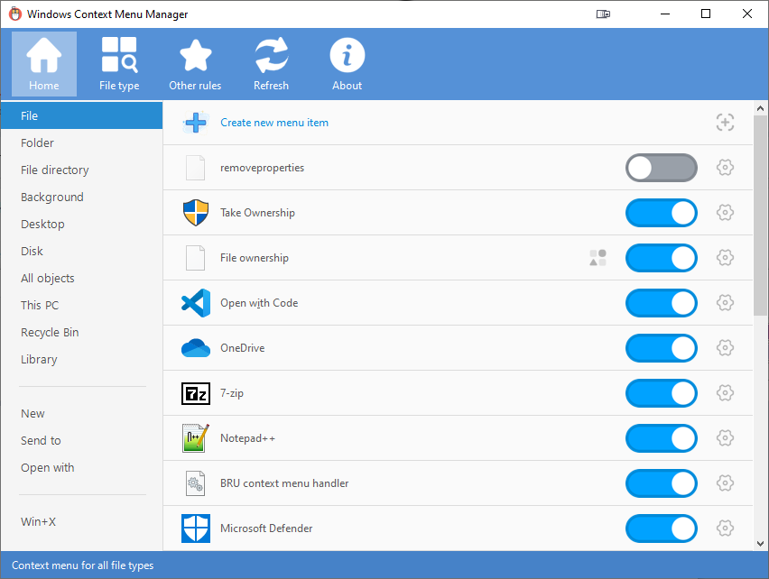
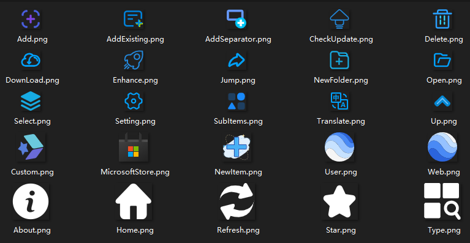

**[简体中文](README.md)** | **English**
# ContextMenuX

------
> 🖱️ A program to manage the Windows right-click context menu.

## Key features
* Enable and disable context menu options for files, folders, submenus (e.g. open, send to), Internet Explorer, and Win+X
* Modify menu names and icons
* Delete context menu entries
* Navigate menus in the registry or File Explorer
* Add custom menu items and commands

## Supported systems and features
* Windows Vista, 7, 8, 8.1, 10, 11
* 32 and 64 bit operating systems
* Support for display scaling, optimal at 150% DPI
* Localization support

## Screenshots

## Third-party resources
* Main program icon from [EasyIcon][EasyIcon] ![][AppIcon]
* [Button icons][AppImage] from [Alibaba Iconfont][IconFont]

## Notices
* Some special menu items (Shell extensions, file encryption) may not be displayed in the context menu, but will still show as enabled within the program; this is normal.
* Different context menu manager programs may use different methods for disabling menu options. Using multiple managers at the same time is not recommended. While other programs may use destructive methods, this program utilizes the registry keys provided by the system to hide menu items when possible.
 If you have used other context menu managers in the past, use that program to restore the menu items before using this one in order to avoid any potential issues.
* This program is not designed to perform clean uninstalls; however, it can help you find the registry and file locations of menu items so that they can be modified. If you are not familiar with such operations, it is recommended you use the enable/disable functions only.

## Credits & Acknowledgments
* This project is refactored from and based on the excellent open-source project [ContextMenuManager](https://github.com/BluePointLilac/ContextMenuManager) created by **BluePointLilac**.
* Sincere thanks to the original author for the great contribution and open-source foundation!
* Thanks to [PcMoe][PcMoe] admin @坑晨 and community contributors.

## License
* Licensed under [GNU General Public License v3.0 (GPL-3.0)](LICENSE).

  [EasyIcon]: https://www.easyicon.net/1208132-mouse_icon.html
  [AppIcon]: ContextMenuX/Properties/AppIcon.ico
  [AppImage]: ContextMenuX/Properties/Resources/Images
  [IconFont]: https://www.iconfont.cn
  [PcMoe]: http://www.pcmoe.net
  [.NET Framework Runtime Library]: https://dotnet.microsoft.com/download/dotnet-framework
